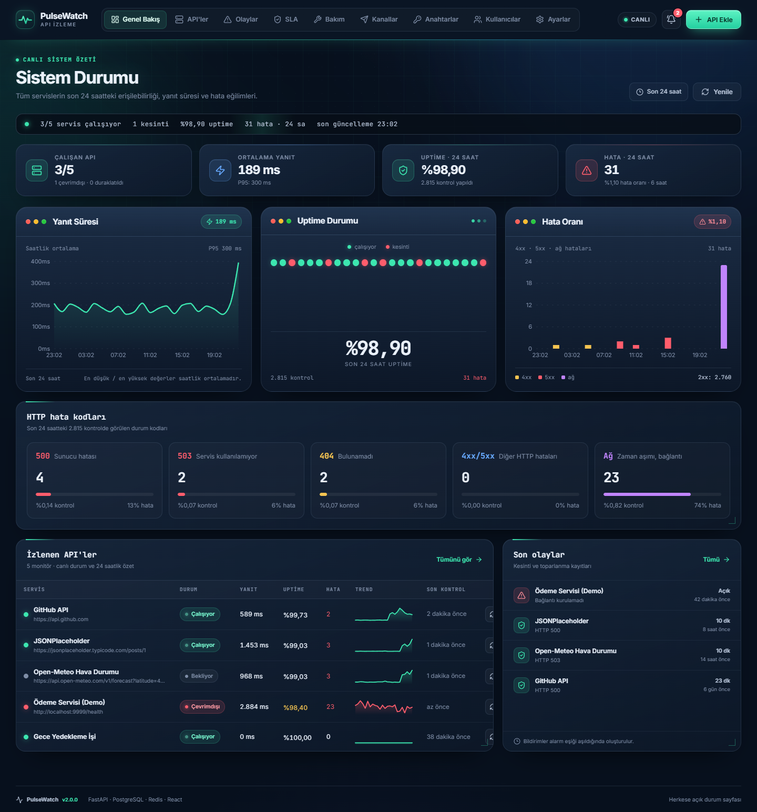
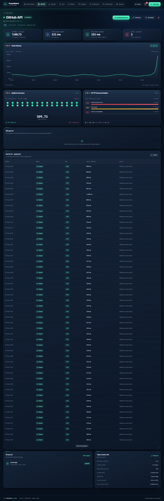
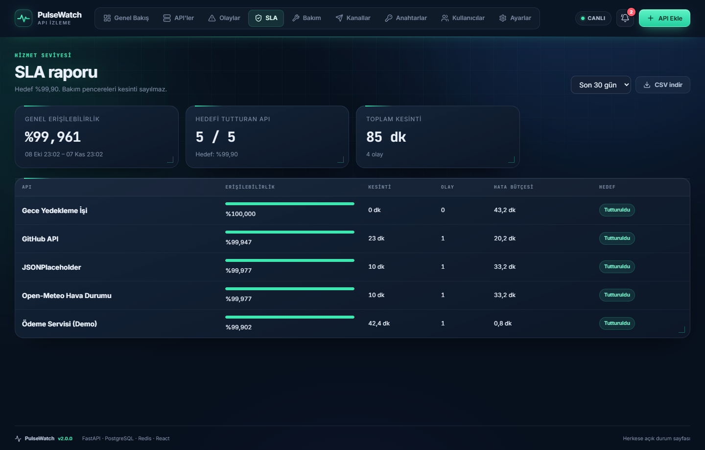
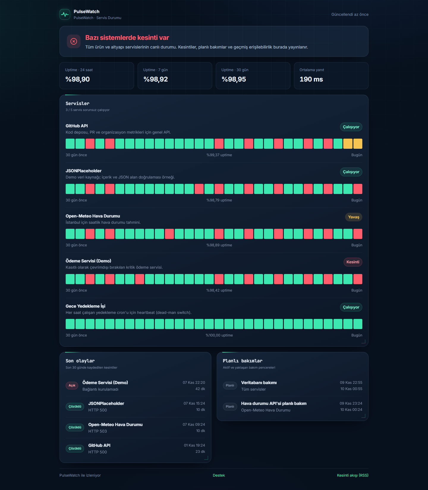
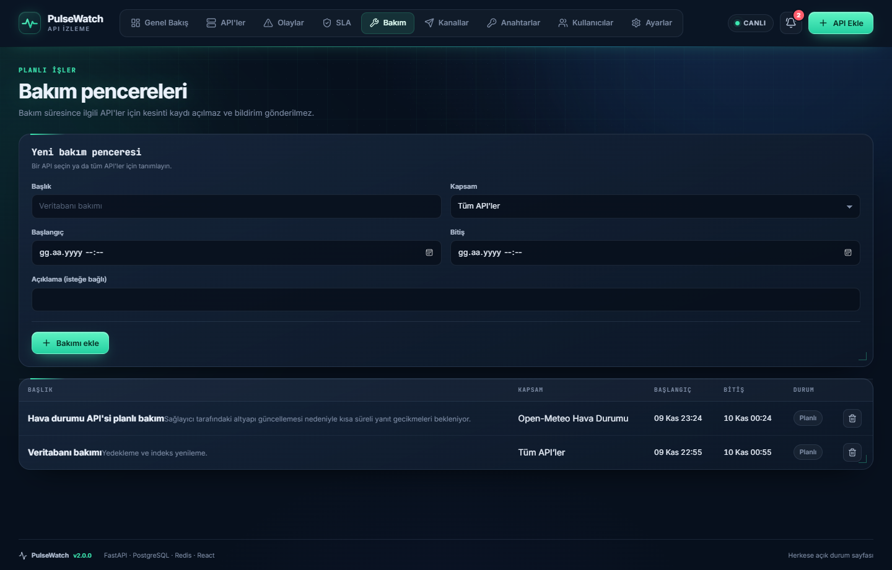
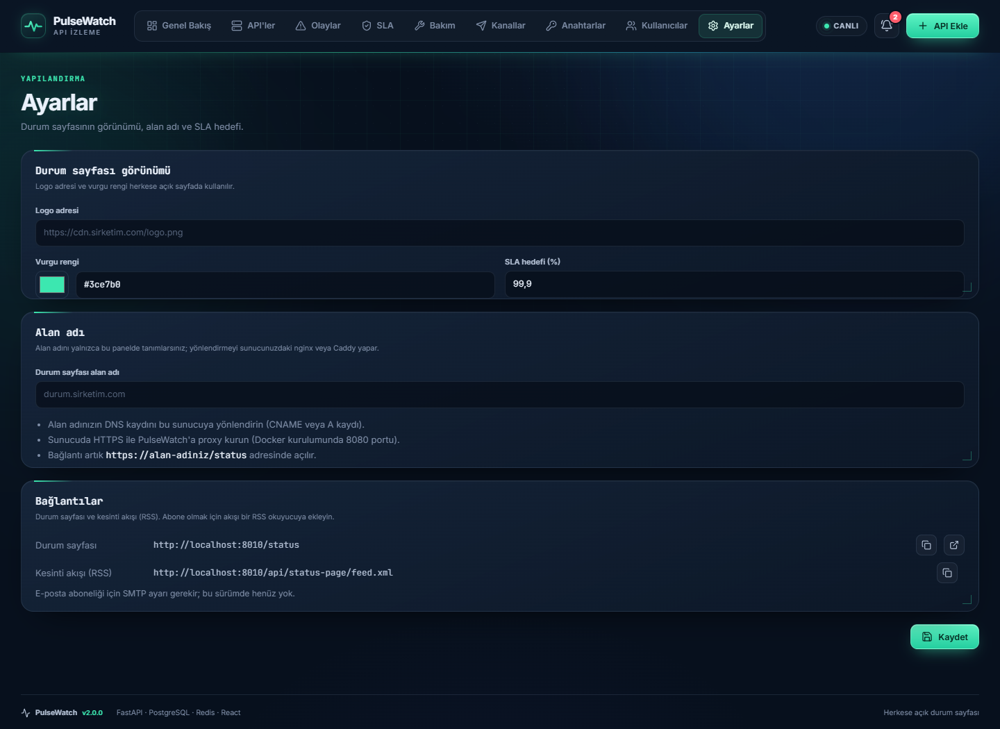

# PulseWatch

Web sitelerini ve API'leri izleyen bir araç. Her birini belli aralıklarla kontrol eder, yanıt süresini, HTTP hata kodlarını ve uptime oranını kaydeder. Bir servis üst üste hata verirse Slack, Discord, Telegram ya da kendi webhook adresinize bildirim gönderir.

Backend FastAPI, arayüz React ile yazıldı. Veritabanı olarak SQLite ya da PostgreSQL kullanılabilir.

## Neler yapabiliyor

- HTTP(S) kontrolleri ve heartbeat (zamanlanmış görevler için)
- Panel: yanıt süresi, uptime, hata kodları, açık olaylar
- Bildirim: Slack, Discord, Telegram ve webhook
- SLA raporu, CSV olarak indirilebilir
- Bakım pencereleri: bu sürede bildirim gönderilmez
- Herkese açık durum sayfası ve RSS akışı
- Yönetici ve görüntüleyici rolleri
- Monitörleri JSON olarak dışa ve içe aktarma
- Prometheus metrikleri

## Ekran görüntüleri

<table>
<tr>
<td align="center"><a href="docs/screenshots/dashboard.png"></a><br>Genel bakış</td>
<td align="center"><a href="docs/screenshots/monitor-detail.png"></a><br>API detayı</td>
<td align="center"><a href="docs/screenshots/sla.png"></a><br>SLA raporu</td>
</tr>
<tr>
<td align="center"><a href="docs/screenshots/status-page.png"></a><br>Durum sayfası</td>
<td align="center"><a href="docs/screenshots/maintenance.png"></a><br>Bakım</td>
<td align="center"><a href="docs/screenshots/settings.png"></a><br>Ayarlar</td>
</tr>
</table>

## Windows'ta çalıştırma

1. Python 3.11+ ve Node.js 20+ kurulu olsun.
2. `start.bat` dosyasını çalıştırın. Tarayıcı http://localhost:8010 adresinde açılır.
3. Durdurmak için `stop.bat` çalıştırın.

Yerel sürümde giriş ekranı yoktur. Sunucu yalnızca kendi bilgisayarınızdan erişilir.

## Docker ile çalıştırma

1. Docker Desktop açık olsun.
2. `.env.example` dosyasını `.env` adıyla kopyalayın.
3. `docker compose up --build` komutunu çalıştırın.
4. http://localhost:8080 adresini açıp giriş yapın.

Varsayılan giriş bilgisi `.env.example` içinde yazılı: `admin@pulsewatch.local` / `pulsewatch`. Sunucuyu internete açmadan önce `ADMIN_PASSWORD` ve `JWT_SECRET` değerlerini değiştirin.

## Ayarlar

Ayarlar ortam değişkeniyle yapılır. Hepsi `.env.example` dosyasında açıklamalı.

## Testler

```
cd backend
pytest
ruff check app tests
```

## Sınırlar

- TCP ve DNS monitörü yok.
- E-posta bildirimi yok.
- Bölge ajanının sonuçları yalnızca veri olarak görünür, bildirim göndermez.

Rozet, RSS, JSON API, webhook ve Prometheus örnekleri için [docs/entegrasyon.md](docs/entegrasyon.md) dosyasına bakın.
